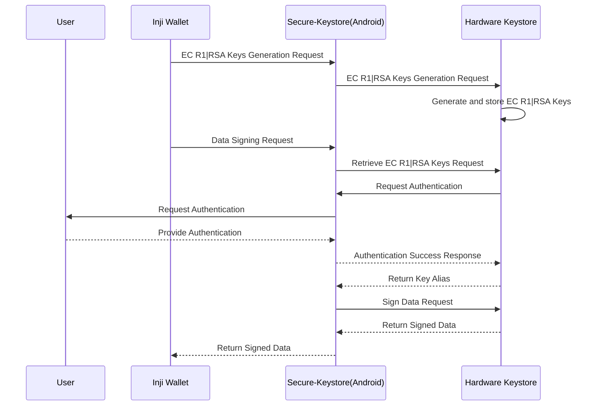
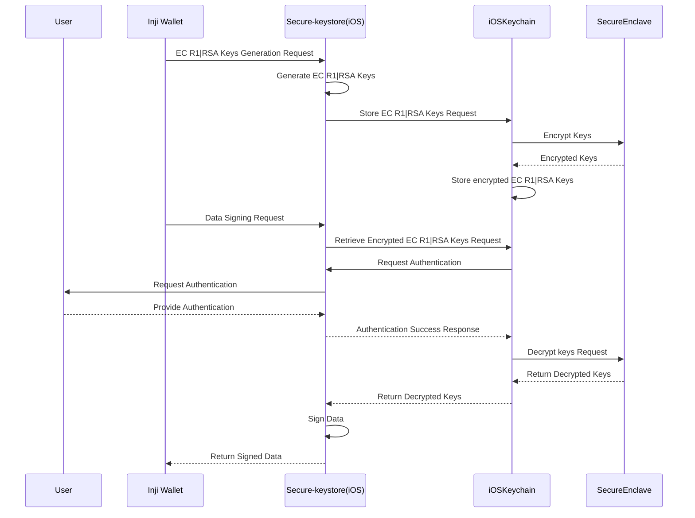
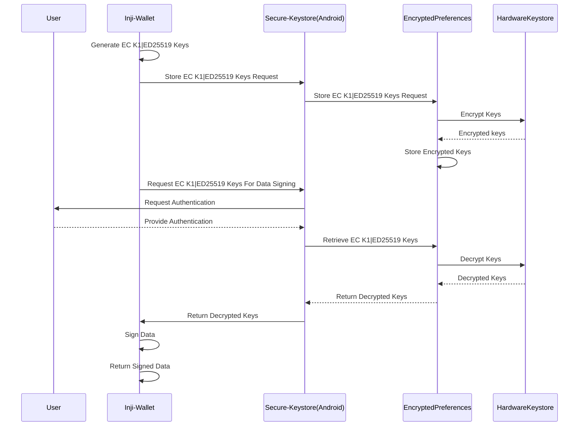
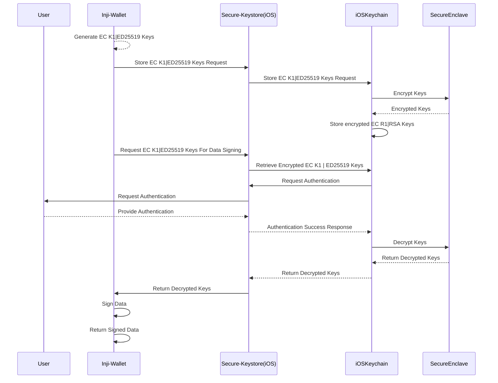

# Inji Wallet - Key Management Feature

## Overview

The Inji Wallet supports **RSA, EC R1, EC K1, and ED** keys for signing operations. This document provides a detailed breakdown of the key management process for each key type and its interaction with different system components.

## Supported Key Types

- RSA-2048
- EC R1
- EC k1
- Ed25519

---

## Key Priority Order

When downloading a credential via OpenID4VCI, the wallet picks the first key type in the priority order whose algorithm is listed in the issuer's `proof_types_supported.jwt.proof_signing_alg_values_supported`. If no key type matches, or the issuer does not list any algorithms, the first key type in the order is used.

The default priority order is:

1. ED25519 (`Ed25519`)
2. EC K1 (`ES256K`)
3. EC R1 (`ES256`)
4. RSA (`RS256`)

The default order can be configured through Mimoto using the `mosip.inji.keyPriorityOrder` property, which is returned as `keyPriorityOrder` in the `/allProperties` response:

```properties
mosip.inji.keyPriorityOrder=Ed25519,ES256K,ES256,RS256
```

- The configured order is applied only when the wallet generates its keys, i.e. on a fresh install. Existing installations keep their current order.
- The user can change the order at any time from **Settings → Key Management**, and that order is never overwritten by the configuration.
- Unsupported or duplicate values are ignored, and supported key types missing from the configuration are appended in the default order.
- If the configuration cannot be fetched (e.g. no network on first launch) or the property is not set, the default order is used.

---

## Key Management Flow:

**_RSA & EC R1_**

**_Android Flow_**



**_iOS Flow_**



The RSA and EC R1 keys are directly supported by the android hardware-keystore, hence all cryptographic operations like signing take place there itself.
For iOS we make use of keyWrapping to store the keys safely in keychain, and use them for necessary operations.

---

**_EC K1 & ED_**

**_Android Flow_**



**_iOS Flow_**



The EC K1 and Ed25519 keys are not directly supported by hardware keystore in android or iOS, hence in both platforms we make use of secure storage areas; encryptedPreferences in android, keychain in ios, with the help of key wrapping.

---
