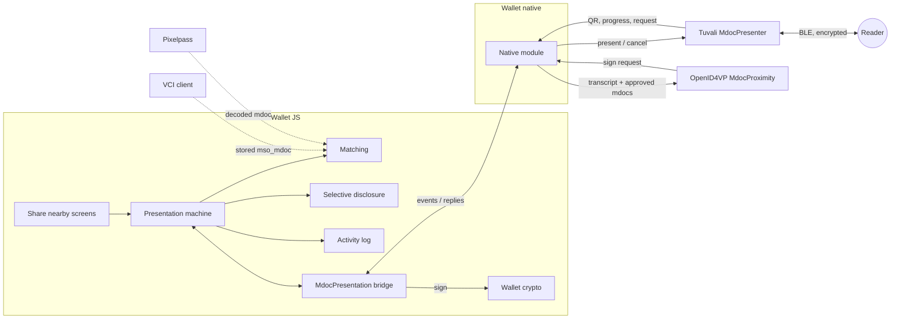
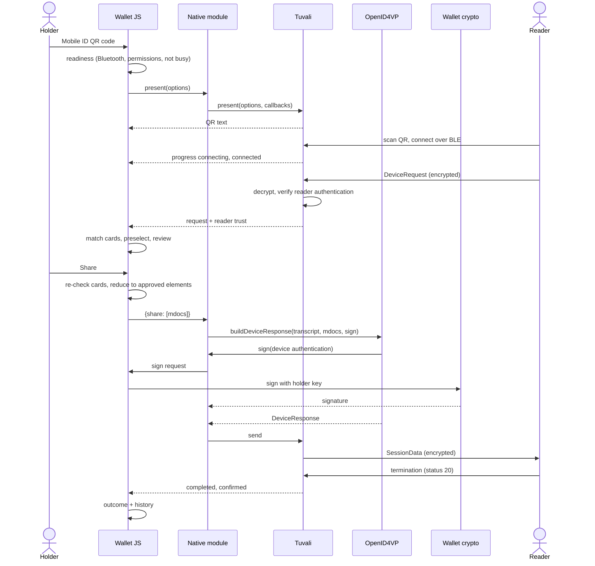

# In-person mdoc sharing (ISO/IEC 18013-5 proximity)

Design record for Share nearby → Mobile ID QR code: the libraries involved, how the wallet ties
them together, and the architecture and business decisions behind the flow.

## Overview

The holder shows a QR code; an ISO 18013-5 reader scans it and connects over Bluetooth LE; the
reader requests data elements from one or more documents; the holder approves; the wallet
returns a signed `DeviceResponse`. Both devices work offline.

v1 covers QR engagement with the wallet as BLE central (mdoc central client mode). NFC
engagement, the BLE peripheral role, L2CAP and server retrieval are out of scope.

## Components

| Component                                                                                     | Platform      | Role in this flow                                                                                                                                                                                                                                                                                            |
| --------------------------------------------------------------------------------------------- | ------------- | ------------------------------------------------------------------------------------------------------------------------------------------------------------------------------------------------------------------------------------------------------------------------------------------------------------ |
| **Tuvali** (`tuvali`, `tuvali-ios-swift`)                                                     | Kotlin, Swift | Owns the ISO 18013-5 session: device engagement and QR text, BLE central transport, session key agreement and encryption, `DeviceRequest` parsing, reader authentication, timeouts and termination. Public API: `MdocPresenter.present(options, callbacks)` and `cancel()`. Knows nothing about credentials. |
| **inji-openid4vp** (`inji-openid4vp`, `inji-openid4vp-ios-swift`)                             | Kotlin, Swift | `MdocProximity.buildDeviceResponse(sessionTranscript, credentials, sign)`: builds the `DeviceResponse` with device authentication over the ISO session transcript. Asks the caller to sign; holds no keys.                                                                                                   |
| **inji-vci-client**                                                                           | Kotlin, Swift | Downloads `mso_mdoc` credentials bound to the wallet's holder key. The stored credential is the issued `IssuerSigned` CBOR, unchanged.                                                                                                                                                                       |
| **Pixelpass**                                                                                 | Kotlin, Swift | Decodes the stored CBOR into JSON (`processedCredential`) for display and matching. Not used to build the answer.                                                                                                                                                                                            |
| **Wallet JS** (`machines/mdocPresentation`, `shared/mdocPresentation`, `screens/ShareNearby`) | React Native  | Business rules and UI: readiness, request matching, card selection, consent, selective disclosure, outcomes and history. Decides what is sent.                                                                                                                                                               |
| **Wallet native bridge** (`InjiMdocPresentationModule.kt`, `RNMdocPresentationModule.swift`)  | Kotlin, Swift | Connects Tuvali and OpenID4VP inside the native layer and exposes one session to JS through events and two reply methods. Keeps the session transcript native.                                                                                                                                               |
| **Wallet crypto** (`cryptoUtil`, `signDataForVpPreparation`)                                  | JS            | Signs device authentication with the holder key for the requested algorithm, the same key bound at download.                                                                                                                                                                                                 |

### How they connect

Tuvali and OpenID4VP never call each other; the native module passes Tuvali's session
transcript to OpenID4VP and OpenID4VP's response back to Tuvali.

### Bridge contract

| Native → JS event   | Payload                                                                                                          | JS reply                                                                                   |
| ------------------- | ---------------------------------------------------------------------------------------------------------------- | ------------------------------------------------------------------------------------------ |
| `onMdocQrReady`     | `qrText` (`mdoc:` engagement)                                                                                    | none                                                                                       |
| `onMdocProgress`    | `waitingForReader`, `connecting`, `connected`, `requestReceived`, `sendingResponse`                              | none                                                                                       |
| `onMdocRequest`     | request number, requested documents (docType, namespaces, element → intent to retain), reader trust per document | `sendMdocDecisionFromJS`: `{share: [base64url mdoc, ...]}`, `{decline: true}` or `{error}` |
| `onMdocSignRequest` | `dataToSign`, `signatureAlgorithm`, `holderKeyReference`                                                         | `sendMdocSignatureFromJS`: `{signature}` or `{error}`                                      |

`present(options)` resolves with the session result: completed (confirmed by reader or not),
declined, cancelled, or failed with a reason. Options carry trusted reader roots and the
engagement and inactivity timeouts.

## Flow

On Decline, Tuvali ends the session with status 20 and nothing is sent. A reader may send a
further request instead of ending the session; the flow returns to review.

## Architecture decisions

**A1. Tuvali owns the ISO session.** Engagement, transport, session encryption, request parsing
and reader authentication live in Tuvali's native code on both platforms, behind one
`present` API, so any wallet can reuse it. Chosen over a TypeScript engine in the wallet: effort
was similar and native code is easier to maintain alongside the existing Tuvali transport.

**A2. OpenID4VP builds the answer; the wallet connects the two.** `DeviceResponse` building and
device authentication sit with the existing online mdoc code in OpenID4VP, which gained a
proximity entry point taking an external session transcript. Tuvali and OpenID4VP have no
dependency on each other.

**A3. Callback-style session API.** One suspending `present` call with callbacks for QR,
progress and request; `onRequest` waits for the holder and returns Send(bytes) or Decline. The
same shape is used on Android and iOS and mirrors the VCI client's callbacks.

**A4. Policy stays in the wallet.** Libraries carry no business rules: which cards match, what
is shareable, what is disclosed and what is logged are decided in wallet JS, so they can change
without library releases.

**A5. Keys stay in the wallet.** OpenID4VP asks for a signature through a callback; the wallet
signs with its holder key. Libraries never see private keys.

**A6. Session transcript stays native.** The transcript goes from Tuvali to OpenID4VP inside the
native module; JS sees only the request, the decision and the bytes to sign.

**A7. Selective disclosure in the wallet, reusing develop.** The stored mdoc is reduced to the
approved elements with the existing `filterMdocCredential`; kept items and `issuerAuth` stay
byte-identical, so digests and the issuer signature verify at the reader.

**A8. v1 scope: wallet as BLE central, QR engagement only.** Matches the readers tested
(Multipaz Test App, Multipaz Identity Reader, EUDI Proximity Verifier). The peripheral role and
NFC come later.

**A9. One session at a time.** The bridge allows one presentation; it cannot start while Receive
card (Tuvali share) is active, and the scan machine owns readiness and background cancellation.

**A10. Shared test vectors.** Kotlin and Swift implementations are checked against the same ISO
Annex D vectors, and the DeviceResponse builders byte for byte against shared vectors.

**A11. No platform upgrades.** Built within React Native 0.74.5, Tuvali's Kotlin version and
iOS 13; iOS CBOR uses the SwiftCBOR fork already used by Pixelpass.

## Business decisions

**B1. What can be shared.** Only `mso_mdoc` cards whose MSO `docType` equals the requested
`docType`. A card is offered when it holds at least one requested element; requested elements
it lacks are shown as "not on your card" and never sent.

**B2. Expired and revoked cards.** Expired cards can be shared with a warning naming the expiry
date (the reader sees the MSO validity anyway). Cards marked revoked by the status list check
cannot be selected or shared. Suspension and not-yet-valid cards are not handled separately.

**B3. Selection.** One card is preselected per requested document: a valid card before an
expired one, then the card holding the most requested elements, then wallet order. Every
requested element starts ticked; the holder unticks what they do not want to share.

**B4. Every requested document must be answered.** Share is enabled only when each requested
document has a selected card with at least one ticked element it holds. With no card for any
document, the holder can only end the session or add a card. Answering a subset with
`documentErrors` is a possible later change.

**B5. Only approved elements leave the phone.** Cards are re-matched against the wallet just
before sending, so a card removed or revoked during review is not sent.

**B6. Consent per request.** Every request, including further requests in the same session,
needs its own approval.

**B7. Reader trust.** Reader authentication results are shown as verified, unverified or failed
check. No trusted reader roots are configured yet, so signed readers show as unverified. A
failed check makes Decline the main action; Share anyway remains.

**B8. Face verification.** Share with selfie verification follows the online sharing rule and
needs a face match before signing.

**B9. Timeouts.** A code is valid for 30 s (ISO recommends no less). Once connected, each wait,
including the holder's review, allows 300 s. Cancel, Back or sending the app to the background
ends the session.

**B10. History.** One entry per card per response: shared, sent but not confirmed, stopped,
interrupted, verifier problem or failed, plus declines and failed face checks. Sessions that end
before any answer are not logged.

## Known limitations

- Trusted reader roots not configured (B7).
- No partial answers across documents (B4).
- No signal for photo transfer progress, signal loss or card updates.
- iOS holder ES256 key is generated in JS and exportable (inji-wallet#2690).
- `readerAuthAll` from the newer DeviceRequest version is not checked; such readers show as not
  signed.
