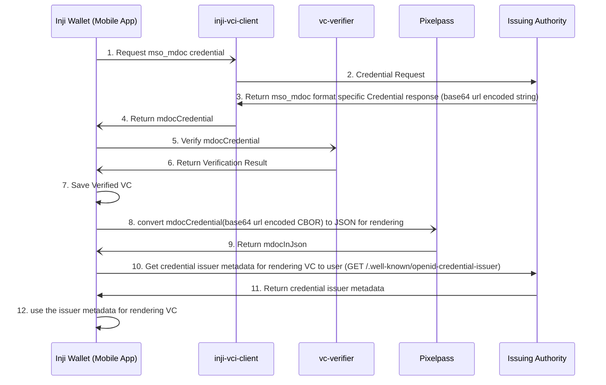

## Support of credential format mso_mdoc

This document provides a comprehensive overview of the process for downloading and rendering an mDoc, adhering to the OpenID4VCI specification. It details the necessary steps to retrieve, validate, and present credentials in the mso_mdoc format.
### Actors involved
1. Inji Wallet
2. Issuing authority
3. _inji-vci-client_ (Library for downloading credential)
4. _vc-verifier_ (library for verification of downloaded VC)
5. _pixelpass_ (In case of mdoc, this library for converting base64 url encoded mdoc credential to JSON for rendering purpose)

###  Sequence diagram - download & view mso_mdoc credential format VC



#### Steps involved
##### 1. Make credential request

Establish communication with the _inji-vci-client_ to submit a credential request to the issuing authority.

````
{
   "format": "mso_mdoc",
   "doctype": "org.iso.18013.5.1.mDL",
   "claims": {
      "org.iso.18013.5.1": {
         "given_name": {},
         "family_name": {},
         "birth_date": {}
      },
   },
   "proof": {
      "proof_type": "jwt",
      "jwt": "eyJraWQiOiJkaWQ6ZXhhbXBsZ...KPxgihac0aW9EkL1nOzM"
   }
}
````
##### 2. Receive the credential response
The _inji-vci-client_ submits the credential request to the issuing authority. Once the response is received, it is returned to the Wallet.

```
{  
	"credential": "<base-64-url-encoded-cbor-data>"  
}  
```
##### 3. Perform vc verification

After obtaining the credential from the issuing authority through the _inji-vci-client_ library, a verification process ensures that the issued Verifiable Credential (VC) remains unaltered. For credentials in the mso_mdoc format, the following validations are performed using the _vc-verifier_ library:

1. [x] Confirm the credential has not been tampered with. (Cryptographic Signature/Hash Verification)
2. [x] Issuing Country Validation.
3. [x] Document Type Check.
4. [x] Confirms the credential is within its valid usage period. (Validity Information Check)
5. [x] Verifies the integrity of the certificate chain to ensure that the credential is issued by a legitimate and authorized issuer. (Document Signer certification validation) [currently not implemented]

##### 4. Rendering of mso_mdoc VC

- In the case of an mso_mdoc format Verifiable Credential (VC), the issuer provides the credential as Base64-encoded CBOR data. The Wallet interacts with the _pixelpass_ library to convert this encoded CBOR data into JSON format, which is then used for rendering the credential.
- The processed credential is not stored in persistent storage or shared via Bluetooth to optimize storage efficiency and transmission size. Instead, it is maintained only within the state machine context, ensuring that repeated interactions with PixelPass are avoided for rendering.
- Once the processed VC is obtained, the issuer's well-known configuration is used to determine how the credential should be displayed, including labeling and field ordering.

- #####  VC Detail View Rendering:
  - Field Labels:
  The labels displayed for each field are derived from the Credential Issuer's metadata claims under the display attribute.
  Reference: OpenID4VCI Spec - Credential Issuer Metadata. 
  - Field Ordering:
    - As per OpenID4VCI Draft 13, the order property in the issuer’s well-known configuration defines the order of fields to be displayed.
    This property contains an array of claims.display.name values, specifying the sequence in which the Wallet should present the fields. 
    -   Example:
       ` org.iso.18013.5.1\~given_name` (` Format: {namespace}\~{claim-value-name}`)

This structured approach ensures that the credential is rendered accurately and efficiently while maintaining a lightweight storage and transmission footprint.

### SVG rendering POC

The optional mdoc path reuses Inji VC Renderer for hosted template fetching and
JSON Pointer substitution. Both the saved credential screen and received
credential preview use `useCredentialSvg`. No `renderMethod` is added to the
signed mdoc.

#### Hosting and configuration

The SVGs live on the `gh-pages` branch of **inji-config** under `mdoc/`
(one file per docType, named `<docType>.svg`) and are served by
GitHub Pages, next to the issuer logos and card backgrounds already hosted
there. Which SVG each docType uses is environment configuration, kept with the
rest of it in `inji-default.properties` on the inji-config main and
environment branches:

```properties
mosip.inji.mdocTemplateBaseUrl=https://inji.github.io/inji-config/mdoc/
mosip.inji.mdocTemplates={"org.iso.18013.5.1.mDL":"org.iso.18013.5.1.mDL.svg", ...}
```

Mimoto already returns every `mosip.inji.*` property from
`/v1/mimoto/allProperties`, so no backend change is involved. The wallet uses
Mimoto's two values when it provides both. Otherwise it uses its own defaults from
`shared/InitialConfig.ts`, which reads them from `.env`:

```dotenv
MDOC_SVG_TEMPLATE_BASE_URL=https://<your-template-host>/mdoc/
MDOC_SVG_TEMPLATES={"org.iso.18013.5.1.mDL":"org.iso.18013.5.1.mDL.svg"}
```

Each value falls back on its own. Restart Metro with its transform cache reset
after changing `.env`. Without a base URL
and a mapping, mdoc cards keep the ordinary field view. The wallet sends no
credential fields to the template host.

#### Template selection

The mapping uses exact, case-sensitive `docType` values and SVG file names
under the base URL:

| Document | docType | SVG |
| --- | --- | --- |
| mDL | `org.iso.18013.5.1.mDL` | `org.iso.18013.5.1.mDL.svg` |
| Photo ID | `org.iso.23220.photoID.1` | `org.iso.23220.photoID.1.svg` |
| Health ID | `eu.europa.ec.eudi.hiid.1` | `eu.europa.ec.eudi.hiid.1.svg` |
| Vehicle Registration | `org.iso.7367.1.mVRC` | `org.iso.7367.1.mVRC.svg` |
| Photo ID (lower-case spelling, e.g. Paradym) | `org.iso.23220.photoid.1` | `org.iso.23220.photoID.1.svg` |
| EU PID | `eu.europa.ec.eudi.pid.1` | `org.iso.23220.photoID.1.svg` |

Issuers name the same data differently, so `createMdocDisplayModel` fills the
claim names the templates use from the names an issuer actually sent. It only
fills gaps and never replaces an issuer value:

- name variants: `family_name` / `family_name_unicode` / `family_name_latin1`,
  the same for given name, issuing authority and address, and
  `birth_place` / `birthplace`;
- the `org.iso.23220.photoid.1` namespace is also exposed as
  `org.iso.23220.photoID.1`;
- vehicle expiry and issuing country fall back from `org.iso.7367.1` to
  `org.iso.23220.1`, and a missing `un_distinguishing_sign` shows the issuing
  country;
- an EU PID is mapped onto the identity card claims (names, dates, authority,
  country, nationality, place of birth, document number, personal
  administrative number, portrait); lists and `place_of_birth` maps are written
  as one line of text.

Elements an issuer does not send still render as `-`.

The Photo ID, Health ID and Vehicle Registration bindings follow Animo's
[Photo ID](https://github.com/animo/openid4vc-playground/blob/main/agent/src/issuers/credentials/photoIdMdoc.ts),
[Health ID](https://github.com/animo/openid4vc-playground/blob/main/agent/src/issuers/krankenkasse.ts)
and [Vehicle Registration](https://github.com/animo/openid4vc-playground/blob/main/agent/src/issuers/mvrc.ts)
source schemas, checked against live issuer metadata on 12 November 2026.

The wallet reads docType from the original document root or the Mobile Security
Object inside `issuerAuth` when only IssuerSigned is stored. Unsupported types,
missing types, missing configuration, fetch failures and empty results fall back
to the field view. Adding another supported type
requires publishing its SVG and adding a mapping entry,
without teaching the native renderer about that document type.

#### Display model and asset contract

`createMdocDisplayModel` creates an ephemeral document with namespace-preserving
`claims`, embedded `portraits` and `signatures` (from `portrait` and
`signature_usual_mark`), and a wallet-owned `renderMethod` referencing
the selected template. It accepts the decoded `issuerSigned.nameSpaces` and
root `nameSpaces` variants.

```xml
<text>{{/claims/org.iso.18013.5.1/family_name}}</text>
<image xlink:href="{{/portraits/org.iso.18013.5.1}}"/>
<image xlink:href="{{/signatures/org.iso.18013.5.1}}"/>
<text>{{/claims/org.iso.7367.1/vehicle_holder/0/family_name_unicode}}</text>
```

Nested maps and arrays remain addressable by JSON Pointer. Use RFC 6901 escaping
(`~1` for `/`, `~0` for `~`) in namespace or field segments. Text is XML-escaped
before entering the current renderer, which substitutes strings verbatim.
Numbers retain zero; booleans become `Yes`/`No`; null and unsupported binary
values become `-`. Known date claims display the supplied date portion without
converting timezones. Missing pointers become `-` in the renderer. Long names
are constrained by the prepared asset slots; multilingual overflow still needs
broader visual testing before production use.

The current PixelPass JSON conversion can lose CBOR image bytes by decoding them
as UTF-8. `readOriginalMdoc` recovers portrait and signature images directly from
the original CBOR without changing it or registering global CBOR tag decoders.
JPEG/PNG images are embedded as data URIs; unsupported/missing images use a
transparent image, so a licence without a signature shows an empty field 7. JPEG 2000 conversion remains outside this POC.

#### QR code on the card

Templates may place the renderer's `{{/qrCodeImage}}` placeholder in an
`<image id="qrCodeImage" xlink:href="{{/qrCodeImage}}">` slot; all four hosted
templates do. The wallet passes the QR data to the renderer itself:
`RNPixelpassModule.generateQRData` over the stored credential, the same data as
the field view's QR and the "Tap to zoom QR Code" overlay, so the QR carries the
issuer-signed mdoc and stays verifiable. Without this the renderer would encode
the temporary display document instead.

When the data is too large for a QR, the renderer puts its own "QR Code Not
Generated" image in the slot (id `qrCodeFallbackImage`), the same behaviour as
oversized `ldp_vc` cards, and the zoom button is hidden. Cards with a portrait
(mDL, Photo ID) usually hit this limit; Health ID and Vehicle Registration fit.
If QR data cannot be generated at all, rendering fails and the field view is
shown.

The assets generate no signature, verification badge or inferred age claim.

#### Native boundary and validation

The inspected iOS renderer accepts only `ldp_vc`. The wallet's
`generateMdocDisplayContent` therefore supplies that format to the native generic
JSON-template engine with the temporary display document, plus the credential's
QR data as `qrCodeData` (a new optional argument on both native bridges, `null`
for `ldp_vc`, which keeps the renderer's own QR behaviour). This is a POC
compatibility shim, not a change to the credential's format. Verification,
storage and sharing continue to use the original mdoc. The display document
must never be verified, stored or shared as a credential.

The mdoc method bypasses persistent rendered-SVG caching to avoid credential
content in cache keys and stale output after template edits. Offline caching is
outside this POC. Obsolete asynchronous results are ignored when credentials
change or views unmount. Debug logs report only docType, match status and page
count, not credential contents.

The card list tile reads the holder photo through `getFaceAttribute`. For mdocs
it first recovers a binary (ISO bstr) portrait from the original CBOR, as the SVG
path does, and falls back to the decoded string portrait (Certify) when there is
none.

On the detail screen, SVG cards of every format show the activation section below
the card, as field-view cards do, and a double tap opens the card full screen,
turned sideways.

Tests cover the allProperties and `.env` configuration, exact template selection, namespace and nested
claim mapping, XML escaping, dates, binary portrait and signature recovery, MSO docType
extraction, native bridge input, fallback behavior and obsolete requests.
Device rendering was exercised with a locally served template folder on the Motorola
and connected iPhone; additional document-type and received-preview device
coverage should be recorded separately from unit tests.
